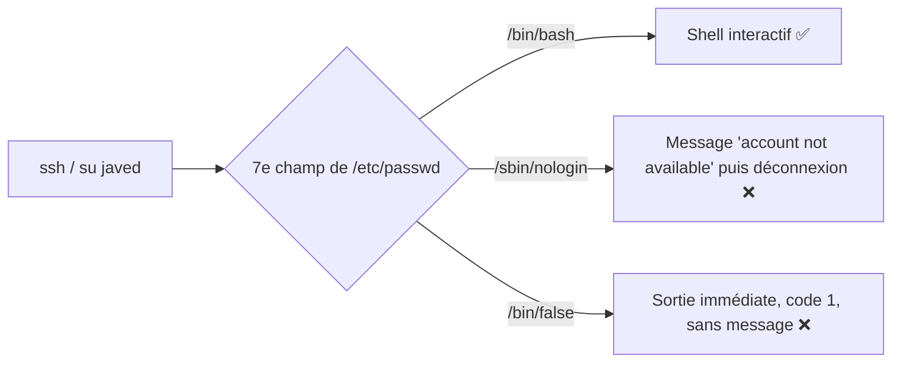

# 🔒 Utilisateur avec shell non interactif

## Résumé

Un **compte de service** (agent de backup, monitoring, appli) doit exister pour posséder des fichiers et lancer des processus, mais **personne ne doit pouvoir s'y connecter**. On lui donne un shell non interactif : `/sbin/nologin`.

## Comment Linux choisit le shell

À la connexion, Linux lit le **7e champ** de `/etc/passwd` et exécute ce programme :

```
javed:x:1002:1002::/home/javed:/sbin/nologin
│     │  │    │   │ │           └─ 7. shell de connexion
│     │  │    │   │ └─ 6. répertoire personnel
│     │  │    │   └─ 5. commentaire (GECOS)
│     │  │    └─ 4. GID
│     │  └─ 3. UID
│     └─ 2. mot de passe (x = stocké dans /etc/shadow)
└─ 1. login
```



## `/sbin/nologin` vs `/bin/false`

| | `/sbin/nologin` | `/bin/false` |
|---|---|---|
| Comportement | Affiche un message poli puis quitte | Quitte sans rien dire |
| Message personnalisable | Oui, via `/etc/nologin.txt` | Non |
| Usage | Standard pour les comptes de service | Plus ancien, plus brutal |

## Commandes

```bash
# Créer un utilisateur avec un shell non interactif
sudo useradd -s /sbin/nologin javed

# Modifier le shell d'un utilisateur existant
sudo usermod -s /sbin/nologin javed

# Vérifier
grep javed /etc/passwd
getent passwd javed

# Tester
sudo su - javed   # → This account is currently not available.

# Exécuter une commande sous ce compte malgré tout
sudo -u javed whoami
```

## À retenir

- Un shell `nologin` **bloque la session interactive**, pas l'existence du compte : on peut toujours lancer un process avec `sudo -u javed`.
- `useradd -s` à la création, `usermod -s` après coup.
- Pour un vrai compte système (pas de home, UID < 1000), on ajoute `-r` : `useradd -r -s /sbin/nologin svc-backup`.
- `/etc/shells` liste les shells « valides » ; `nologin` n'y est généralement pas, ce qui bloque aussi le FTP pour ce compte.

## Source

KodeKloud — 100 Days of DevOps, Day 1
