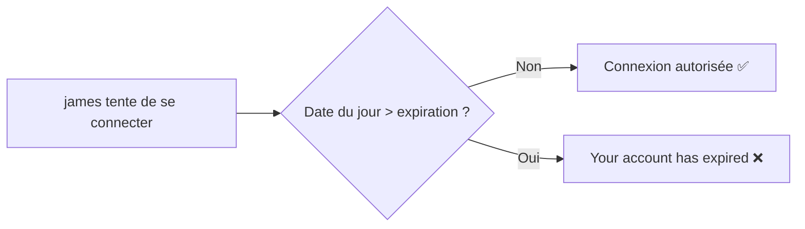

# ⏳ Utilisateur temporaire avec date d'expiration

## Résumé

Pour un accès **limité dans le temps** (prestataire, stagiaire, mission courte), on crée un compte avec une **date d'expiration**. Le jour venu, Linux refuse automatiquement la connexion : plus besoin de penser à supprimer le compte à la main.

## Où est stockée l'expiration ?

Pas dans `/etc/passwd`, mais dans le **8e champ** de `/etc/shadow`, en **nombre de jours depuis le 1er janvier 1970** :

```
james:!!:20396:0:99999:7::20866:
│     │   │     │ │     │ │ └─ 8. expiration du COMPTE (jours depuis 1970) → 2027-02-17
│     │   │     │ │     │ └─ 7. jours de grâce après expiration du mot de passe
│     │   │     │ │     └─ 6. jours d'avertissement avant expiration du mot de passe
│     │   │     │ └─ 5. durée max du mot de passe
│     │   │     └─ 4. durée min entre deux changements
│     │   └─ 3. dernier changement du mot de passe
│     └─ 2. hash du mot de passe (!! = pas encore défini)
└─ 1. login
```



## Expiration du compte vs du mot de passe

| | Expiration du **compte** | Expiration du **mot de passe** |
|---|---|---|
| Commande | `useradd -e` / `chage -E` | `chage -M` |
| Effet | Compte bloqué, plus aucune connexion | L'utilisateur doit changer son mot de passe |
| Cas d'usage | Accès temporaire | Politique de rotation des mots de passe |

## Commandes

```bash
# Créer un utilisateur avec une date d'expiration
sudo useradd -e 2027-02-17 james

# Modifier l'expiration d'un compte existant (2 équivalents)
sudo chage -E 2027-02-17 james
sudo usermod -e 2027-02-17 james

# Supprimer l'expiration
sudo chage -E -1 james

# Vérifier
sudo chage -l james
```

## À retenir

- Format de date : `AAAA-MM-JJ`.
- `chage -l` est la commande de vérification de référence.
- Un compte expiré n'est **pas supprimé** : ses fichiers et son UID restent. Pense au nettoyage (`userdel -r`) plus tard.
- En entreprise, ce besoin est souvent géré par l'annuaire (LDAP, Active Directory) plutôt que par des comptes locaux.

## Source

KodeKloud — 100 Days of DevOps, Day 2
