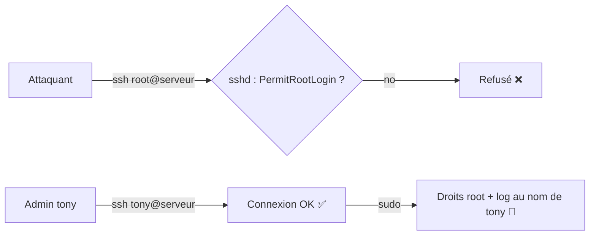

# 🚫 Désactiver la connexion SSH root

## Résumé

`root` existe sur **toutes** les machines Linux : c'est la cible n°1 des attaques par force brute SSH. On interdit donc la connexion directe en root. Les admins se connectent avec **leur propre compte**, puis élèvent leurs droits avec `sudo`. Chaque action est alors **tracée au nom d'une personne**.



## Comment sshd lit sa config

```mermaid
flowchart TD
    A[sshd démarre] --> B[/etc/ssh/sshd_config]
    B -->|Include| C[/etc/ssh/sshd_config.d/*.conf]
    C --> D[Pour chaque directive : la PREMIÈRE valeur lue gagne]
    D --> E[Config active en mémoire]
    E -.->|sshd -T l'affiche| F[Vérification fiable]
```

⚠️ Modifier le fichier ne change rien tant que le service n'est pas **redémarré** (ou rechargé).

## Valeurs de `PermitRootLogin`

| Valeur | Effet |
|---|---|
| `yes` | root peut se connecter (mot de passe ou clé) |
| `prohibit-password` | root uniquement par clé SSH (défaut OpenSSH récent) |
| `forced-commands-only` | root par clé, seulement pour une commande imposée (backup…) |
| `no` | root interdit ✅ |

## Commandes

```bash
# 1. Modifier la directive (ligne commentée ou non)
sudo sed -i 's/^#\?PermitRootLogin.*/PermitRootLogin no/' /etc/ssh/sshd_config

# 2. Tester la syntaxe AVANT de redémarrer
sudo sshd -t

# 3. Appliquer
sudo systemctl restart sshd      # ou : sudo systemctl reload sshd

# 4. Vérifier la config réellement active
sudo sshd -T | grep -i permitrootlogin

# Chercher un override dans les drop-ins
grep -ri permitrootlogin /etc/ssh/sshd_config.d/
```

## À retenir

- **Toujours `sshd -t` avant le restart** : une config cassée = sshd ne redémarre pas = plus d'accès distant.
- `sshd -T` montre la config **effective**, `grep` sur le fichier ne montre que le texte.
- Sur un vrai serveur, garde une **session SSH ouverte** pendant que tu testes la nouvelle config dans une autre.
- `reload` applique sans couper les sessions existantes, `restart` redémarre le démon (les sessions ouvertes survivent généralement).
- À l'échelle, on ne fait pas ça à la main sur 3 serveurs : c'est un cas d'école pour **Ansible** (module `lineinfile` + handler `restart sshd`).

## Bonus : la même chose en Ansible

```yaml
- hosts: app_servers
  become: true
  tasks:
    - name: Désactiver la connexion root SSH
      ansible.builtin.lineinfile:
        path: /etc/ssh/sshd_config
        regexp: '^#?PermitRootLogin'
        line: 'PermitRootLogin no'
        validate: 'sshd -t -f %s'
      notify: restart sshd
  handlers:
    - name: restart sshd
      ansible.builtin.service:
        name: sshd
        state: restarted
```

## Source

KodeKloud — 100 Days of DevOps, Day 3
